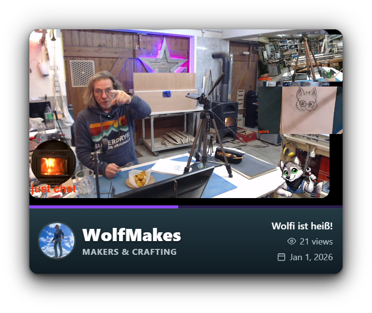
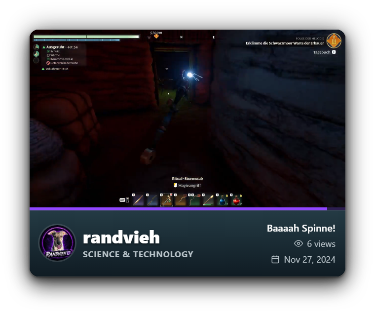
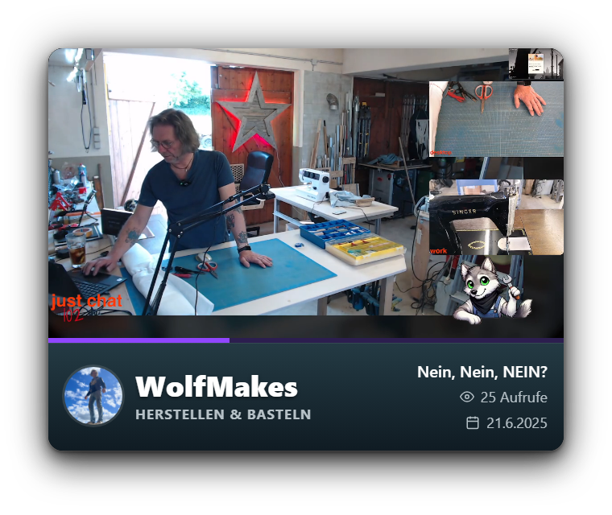
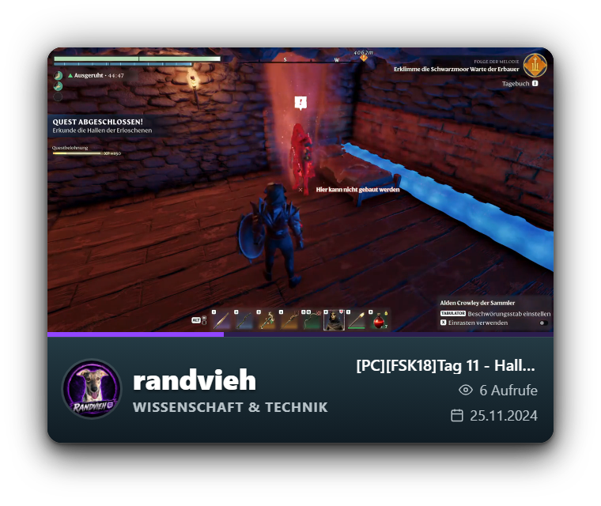

# obs-shoutout-overlay

**[English](#english)** · **[Deutsch](#deutsch)**

---

## English

A shoutout overlay for OBS and Streamer.bot: on `!so <channel>`, on auto-shoutouts and on raids,
OBS shows a card with the channel's profile picture, name and last game and plays one of the
channel's clips.

| `!so WolfMakes` | `!so randvieh` |
|---|---|
|  |  |

*Browser source 760 × 640 with a transparent margin for the shadow: the clip plays, below it a
progress bar, profile picture, name, last game and the clip's title, views and date. Long names are
shrunk to fit, long clip titles are cut with "…". Shown with `?lang=en`; German is the default.*

### Features

- Plays the channel's **newest clip of today** if there is one (e.g. made during the raider's
  stream; max. 30 s).
- Otherwise shows a 20 s excerpt of the channel's stream in the official Twitch player: of the running
  stream if the channel is live (e.g. a raider; with stream title, viewer count and a LIVE badge),
  otherwise from a random point of its last VOD (title, views, date). Ads never reach your stream:
  the player starts muted outside the visible area and only moves into the card once the stream
  itself plays; a commercial break during the excerpt shows banner and profile picture instead.
- Without stream and VOD, or with `?type=clip`, plays a random clip of the channel (top 15 of the last month,
  otherwise all-time; prefers clips of at least 10 s, max. 30 s). Without clips: profile picture
  in front of the channel banner for 8 s.
- Several shoutouts are queued and played one after another.
- No login, no API key, no extra software: plain HTML/JS in an OBS browser source. Profile,
  game and clips come from Twitch's public GraphQL endpoint.
- German or English (`?lang=de|en`), everything else adjustable via URL parameters.
- Ready-made Streamer.bot import: `!so` command, auto-shoutout on raids and for selected
  chatters, Twitch shoutout and chat message.

### How it works

```
Twitch chat / raid
      │
      ▼
Streamer.bot                                        OBS
┌───────────────────────────────┐  WebSocket       ┌─────────────────────────┐
│ [Auto-Shoutout] Shoutout (!so)│  127.0.0.1:8080  │ browser source          │
│ [Auto-Shoutout] Auto-Shoutout │ ───────────────> │ overlay/shoutout.html   │
│ [Auto-Shout] Get Info         │  {"shoutout":    │ (760 × 640)             │
│ [Shoutout] Overlay (C#)       │   {"login":…}}   └────────────┬────────────┘
└───────────────────────────────┘                               │ profile, game, clips
                                                                ▼
                                                         gql.twitch.tv
```

1. **Triggers** in Streamer.bot (group `Auto-Shoutout`, blocking queue `ShoutOut`):

   | Action | Trigger | Does |
   |---|---|---|
   | `[Auto-Shoutout] Shoutout` | command `!so <name>` / `!shoutout <name>` (moderators, 15 s global cooldown) | get user info → Twitch shoutout (only while live) → `[Shoutout] Overlay` → chat message from the bot account → 60 s pause of the queue |
   | `[Auto-Shoutout] Auto-Shoutout` | raid with 2+ viewers, or from `[Auto-Shout] Get Info` | same, for the raider / chatter |
   | `[Auto-Shout] Get Info` | first message of a user in the stream | runs the auto-shoutout for members of a Twitch team or a specific user (adjust to your needs) |
   | `[Shoutout] Overlay` | raid with 0–1 viewers; otherwise called by the actions above | C#: sends the channel to the overlay via `CPH.WebsocketBroadcastJson` |

2. **`[Shoutout] Overlay`** takes the channel from `targetUserName`, else `input0` (without `@`),
   else `userName`, and broadcasts

   ```json
   {"shoutout": {"login": "channel", "displayName": "Channel", "game": "…", "profileImage": "…"}}
   ```

   through the Streamer.bot WebSocket server (event `General.Custom`).

3. **The overlay** listens on `ws://127.0.0.1:8080/`, fetches everything else from Twitch and
   plays the shoutout.

### Files

| Path | Content |
|---|---|
| `overlay/shoutout.html` | the overlay (HTML/JS, no dependencies) |
| `streamerbot/shoutout.sb.txt` | **Streamer.bot import string** (actions, queue, command), exported from Streamer.bot 1.0.7 |
| `streamerbot/ShoutoutOverlay.cs` | C# code of the action `[Shoutout] Overlay`, for reading |
| `streamerbot/actions-shoutout.json`, `commands-shoutout.json` | the same objects as JSON, for reading |
| `obs/shoutout-scene.json` | OBS browser source and scene as used in the original setup, for reference |

The import string contains no credentials (no tokens, passwords or secrets). Streamer.bot uses
its own logged-in Twitch and bot accounts.

### Installation

**Requirements:** OBS Studio 28+, Streamer.bot 1.0+ connected to Twitch (broadcaster and,
recommended, a bot account).

1. **Overlay:** copy `overlay/shoutout.html` to a folder of your choice, e.g. `C:\Streaming\shoutout\`.
   The stream/VOD excerpt needs the page to be served over **http from `localhost`** (the Twitch
   player only runs embedded in a web page whose host name it knows, not under `file://`), e.g. with
   `python -m http.server 7000` in that folder or any local web server. Opened as a local file,
   the overlay always plays clips.
2. **OBS:** create a scene `_Shoutout` with a *Browser* source:
   - URL `http://localhost:7000/shoutout.html` (or *Local file* → `shoutout.html` for clips only)
   - width 760, height **1040**, and in the scene *Edit Transform* → *Crop* bottom **400** (visible:
     760 × 640, 640 px card plus 60 px margin for the shadow). The Twitch player starts in the
     cropped part: it only plays while visible on the page, so it cannot be hidden in the page itself.
     Clips only: height 640 without crop is enough.
   - *Control audio via OBS* on, so the clip sound appears in the mixer
   - add the scene `_Shoutout` as a source to your live scenes and position it.
3. **Streamer.bot:**
   1. *Servers/Clients → WebSocket Server*: enabled, `127.0.0.1`, port `8080`, no authentication.
   2. Click **Import** at the top, paste the content of `streamerbot/shoutout.sb.txt` (or drop the
      file onto the field) and import.
   3. **Enable the command `[So] Shoutout`** – Streamer.bot always exports commands disabled
      (*Commands* → tick *Enabled*).
   4. Adjust to your channel:
      - the **chat message** in `[Auto-Shoutout] Shoutout` and `[Auto-Shoutout] Auto-Shoutout`
        (German by default, "Euer Netflix-Abo ist abgelaufen …"),
      - who gets an **auto-shoutout** in `[Auto-Shout] Get Info` (Twitch team / user name),
      - which account sends the message (bot account by default, so a TTS does not read it out).

### URL parameters

| Parameter | Default | Effect |
|---|---|---|
| `type=live\|vod\|clip` | `live` | `live`: today's newest clip, otherwise excerpt of the running stream, otherwise of the last VOD, otherwise a top clip; `vod`: skips the running stream; `clip`: top clips only |
| `live=<s>` | 20 | length of the stream/VOD excerpt |
| `lang=de\|en` | `de` | language of the overlay (views, date, text without clips, game name) |
| `test=<login>` | – | plays a shoutout on load (also in a normal browser) |
| `max=<s>` | 30 | maximum clip length |
| `min=<s>` | 10 | shorter clips only if the channel has no longer ones |
| `noclip=<s>` | 8 | display time without clips |
| `volume=<0..1>` | 0.8 | volume of clip and excerpt |
| `debug` | – | shows the last log lines in the margin above the card |
| `ws=<url>` | `ws://127.0.0.1:8080/` | Streamer.bot WebSocket |

### Testing

- Open `shoutout.html?test=<channel>&lang=en` in a browser – it plays the shoutout right away
  (via `http://localhost:…` for the live excerpt, otherwise a clip).
- Without chat message and Twitch shoutout: run `[Shoutout] Overlay` via the Streamer.bot
  WebSocket request `DoAction` with the argument `targetUserName`.
- The Twitch shoutout itself (`/shoutout`) only works while you are live.

### Notes

- The overlay uses Twitch's **public GraphQL endpoint** with the Client-ID of the Twitch website
  (no login). This is not an official API; Twitch may change it at any time.
- Clips are played directly from Twitch's CDN.
- The excerpt uses the official embedded Twitch player. Ads are detected by the player's latency
  to the broadcaster (0 during ads); the overlay waits up to 45 s for a pre-roll (VOD: 30 s), then
  falls back to the VOD or a clip. So the shoutout may appear up to ~45 s after the trigger.
- Content classification labels (e.g. ViolentGraphic): the embedded player shows a notice that needs a
  click. The overlay queries the labels of the running stream and the last VOD and skips a labelled
  one (clip instead). If the query fails, it behaves as before.

### License

[MIT](LICENSE)

---

## Deutsch

Ein Shoutout-Overlay für OBS und Streamer.bot: Bei `!so <kanal>`, beim Auto-Shoutout und bei
Raids zeigt OBS eine Karte mit Profilbild, Name und letztem Spiel des Kanals und spielt einen
seiner Clips ab.

| `!so WolfMakes` | `!so randvieh` |
|---|---|
|  |  |

*Browserquelle 760 × 640 mit transparentem Rand für den Schatten: Der Clip läuft, darunter
Fortschrittsbalken, Profilbild, Name, letztes Spiel sowie Titel, Aufrufe und Datum des Clips.
Lange Namen werden verkleinert, lange Clip-Titel mit „…“ gekürzt.*

### Funktionen

- Spielt den **neuesten Clip von heute**, wenn es einen gibt (z. B. im Stream des Raiders entstanden;
  max. 30 s).
- Sonst zeigt es 20 s aus dem Stream des Kanals im offiziellen Twitch-Player: aus dem laufenden Stream, wenn
  der Kanal live ist (z. B. ein Raider; mit Streamtitel, Zuschauerzahl und LIVE-Kennzeichen), sonst
  ab einer zufälligen Stelle des letzten VODs (Titel, Aufrufe, Datum). Werbung landet nie im eigenen
  Stream: Der Player startet stumm außerhalb des sichtbaren Bereichs und kommt erst in die Karte, wenn
  der Stream selbst läuft; bei einer Werbepause während des Ausschnitts zeigt die Karte Banner und
  Profilbild.
- Ohne Stream und VOD oder mit `?type=clip` spielt es einen zufälligen Clip des Kanals (Top 15 des letzten Monats, sonst aller Zeiten;
  bevorzugt Clips ab 10 s, höchstens 30 s). Ohne Clips: 8 s Profilbild vor dem Kanalbanner.
- Mehrere Shoutouts werden gesammelt und nacheinander gezeigt.
- Kein Login, kein API-Schlüssel, keine Zusatzsoftware: reines HTML/JS in einer
  OBS-Browserquelle. Profil, Spiel und Clips kommen vom öffentlichen GraphQL-Endpunkt von Twitch.
- Deutsch oder Englisch (`?lang=de|en`), alles Weitere über URL-Parameter einstellbar.
- Fertiger Streamer.bot-Import: Befehl `!so`, Auto-Shoutout bei Raids und für ausgewählte
  Chatter, Twitch-Shoutout und Chatnachricht.

### Ablauf

Siehe Diagramm im [englischen Teil](#how-it-works).

1. **Auslöser** in Streamer.bot (Gruppe `Auto-Shoutout`, blockierende Warteschlange `ShoutOut`):

   | Aktion | Auslöser | Ablauf |
   |---|---|---|
   | `[Auto-Shoutout] Shoutout` | Befehl `!so <name>` / `!shoutout <name>` (Moderatoren, 15 s globaler Cooldown) | Nutzerinfo holen → Twitch-Shoutout (nur live) → `[Shoutout] Overlay` → Chatnachricht vom Bot-Konto → 60 s Pause der Warteschlange |
   | `[Auto-Shoutout] Auto-Shoutout` | Raid ab 2 Zuschauern, oder aus `[Auto-Shout] Get Info` | wie oben, für Raider bzw. Chatter |
   | `[Auto-Shout] Get Info` | erste Nachricht eines Nutzers im Stream | Auto-Shoutout für Mitglieder eines Twitch-Teams oder einen bestimmten Nutzer (an den eigenen Kanal anpassen) |
   | `[Shoutout] Overlay` | Raid mit 0–1 Zuschauern; sonst von den Aktionen oben aufgerufen | C#: schickt den Kanal per `CPH.WebsocketBroadcastJson` an das Overlay |

2. **`[Shoutout] Overlay`** nimmt den Kanal aus `targetUserName`, sonst `input0` (ohne `@`), sonst
   `userName`, und sendet `{"shoutout": {"login": …}}` über den WebSocket-Server von Streamer.bot
   (Ereignis `General.Custom`).

3. **Das Overlay** lauscht auf `ws://127.0.0.1:8080/`, holt alles Weitere von Twitch und zeigt
   den Shoutout.

### Dateien

| Pfad | Inhalt |
|---|---|
| `overlay/shoutout.html` | das Overlay (HTML/JS, keine Abhängigkeiten) |
| `streamerbot/shoutout.sb.txt` | **Import-String für Streamer.bot** (Aktionen, Warteschlange, Befehl), exportiert aus Streamer.bot 1.0.7 |
| `streamerbot/ShoutoutOverlay.cs` | C#-Code der Aktion `[Shoutout] Overlay`, zum Nachlesen |
| `streamerbot/actions-shoutout.json`, `commands-shoutout.json` | dieselben Objekte als JSON, zum Nachlesen |
| `obs/shoutout-scene.json` | OBS-Browserquelle und Szene aus dem ursprünglichen Aufbau, als Vorlage |

Der Import-String enthält keine Zugangsdaten (keine Tokens, Passwörter oder Secrets).
Streamer.bot nutzt die eigenen angemeldeten Twitch- und Bot-Konten.

### Einrichten

**Voraussetzungen:** OBS Studio ab 28, Streamer.bot ab 1.0 mit Twitch verbunden (Broadcaster und
möglichst ein Bot-Konto).

1. **Overlay:** `overlay/shoutout.html` in einen beliebigen Ordner kopieren, z. B. `C:\Streaming\shoutout\`.
   Für den Ausschnitt aus Stream oder VOD muss die Seite per **http von `localhost`** kommen (der
   Twitch-Player läuft nur eingebettet in eine Webseite mit bekanntem Hostnamen, nicht unter `file://`),
   z. B. mit `python -m http.server 7000` in diesem Ordner oder einem anderen lokalen Webserver. Als
   lokale Datei geöffnet spielt das Overlay immer Clips.
2. **OBS:** Szene `_Shoutout` mit einer *Browser*-Quelle anlegen:
   - URL `http://localhost:7000/shoutout.html` (oder *Lokale Datei* → `shoutout.html`, dann nur Clips)
   - Breite 760, Höhe **1040**, in der Szene *Transformation bearbeiten* → *Zuschneiden* unten **400**
     (sichtbar 760 × 640: Karte 640 px plus 60 px Rand für den Schatten). Im abgeschnittenen Teil startet
     der Twitch-Player: Er spielt nur, wenn er in der Seite sichtbar ist, lässt sich dort also nicht
     verstecken. Nur Clips: Höhe 640 ohne Zuschnitt reicht.
   - *Audio über OBS steuern* an, damit der Clip-Ton im Mixer erscheint
   - die Szene `_Shoutout` als Quelle in die Live-Szenen einbinden und positionieren.
3. **Streamer.bot:**
   1. *Servers/Clients → WebSocket Server*: an, `127.0.0.1`, Port `8080`, ohne Authentifizierung.
   2. Oben auf **Import** klicken, den Inhalt von `streamerbot/shoutout.sb.txt` einfügen (oder die
      Datei auf das Feld ziehen) und importieren.
   3. **Befehl `[So] Shoutout` aktivieren** – Streamer.bot exportiert Befehle immer deaktiviert
      (*Commands* → Haken bei *Enabled*).
   4. An den eigenen Kanal anpassen:
      - die **Chatnachricht** in `[Auto-Shoutout] Shoutout` und `[Auto-Shoutout] Auto-Shoutout`
        („Euer Netflix-Abo ist abgelaufen …“),
      - wer in `[Auto-Shout] Get Info` einen **Auto-Shoutout** bekommt (Twitch-Team / Nutzername),
      - welches Konto die Nachricht schreibt (Standard: Bot-Konto, damit eine TTS sie nicht vorliest).

### URL-Parameter

| Parameter | Standard | Wirkung |
|---|---|---|
| `type=live\|vod\|clip` | `live` | `live`: neuester Clip von heute, sonst Ausschnitt aus dem laufenden Stream, sonst aus dem letzten VOD, sonst ein Top-Clip; `vod`: überspringt den laufenden Stream; `clip`: nur Top-Clips |
| `live=<s>` | 20 | Länge des Ausschnitts aus Stream oder VOD |
| `lang=de\|en` | `de` | Sprache des Overlays (Aufrufe, Datum, Text ohne Clips, Spielname) |
| `test=<login>` | – | spielt beim Laden einen Shoutout ab (auch im normalen Browser) |
| `max=<s>` | 30 | maximale Clip-Länge |
| `min=<s>` | 10 | kürzere Clips nur, wenn der Kanal keine längeren hat |
| `noclip=<s>` | 8 | Anzeigedauer ohne Clips |
| `volume=<0..1>` | 0.8 | Lautstärke von Clip und Ausschnitt |
| `debug` | – | zeigt die letzten Logzeilen im Rand über der Karte |
| `ws=<url>` | `ws://127.0.0.1:8080/` | Streamer.bot-WebSocket |

### Testen

- `shoutout.html?test=<kanal>` im Browser öffnen – spielt den Shoutout sofort ab
  (für den Live-Ausschnitt über `http://localhost:…`, sonst ein Clip).
- Ohne Chatnachricht und Twitch-Shoutout: `[Shoutout] Overlay` über die Streamer.bot-WebSocket-Anfrage
  `DoAction` mit dem Argument `targetUserName` starten.
- Der Twitch-Shoutout selbst (`/shoutout`) klappt nur, während man live ist.

### Hinweise

- Das Overlay nutzt den **öffentlichen GraphQL-Endpunkt** von Twitch mit der Client-ID der
  Twitch-Website (ohne Login). Das ist keine offizielle API; Twitch kann sie jederzeit ändern.
- Clips werden direkt vom CDN von Twitch abgespielt.
- Der Ausschnitt nutzt den offiziellen eingebetteten Twitch-Player. Werbung erkennt das Overlay an der
  Latenz zum Broadcaster (bei Werbung 0); auf Pre-Roll-Werbung wartet es bis zu 45 s (VOD: 30 s), danach
  nimmt es das VOD bzw. einen Clip. Der Shoutout kann also bis zu ~45 s nach dem Auslösen erscheinen.
- Inhaltskennzeichnungen (z. B. ViolentGraphic): Der eingebettete Player zeigt dann einen Hinweis, der einen
  Klick braucht. Das Overlay fragt die Kennzeichnungen des laufenden Streams und des letzten VODs ab und
  überspringt Gekennzeichnetes (dann Clip). Schlägt die Abfrage fehl, verhält es sich wie bisher.

### Lizenz

[MIT](LICENSE)
